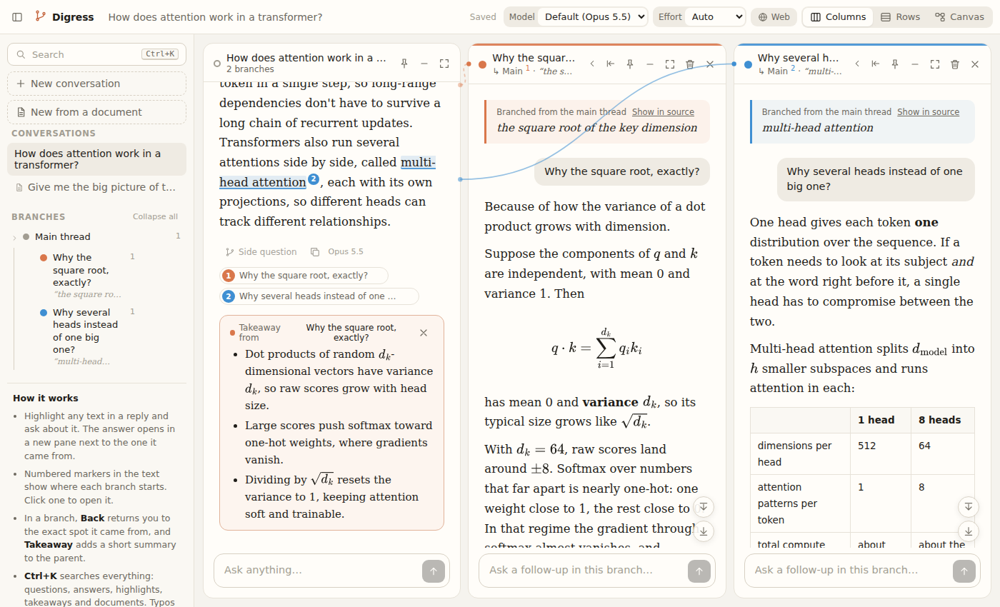
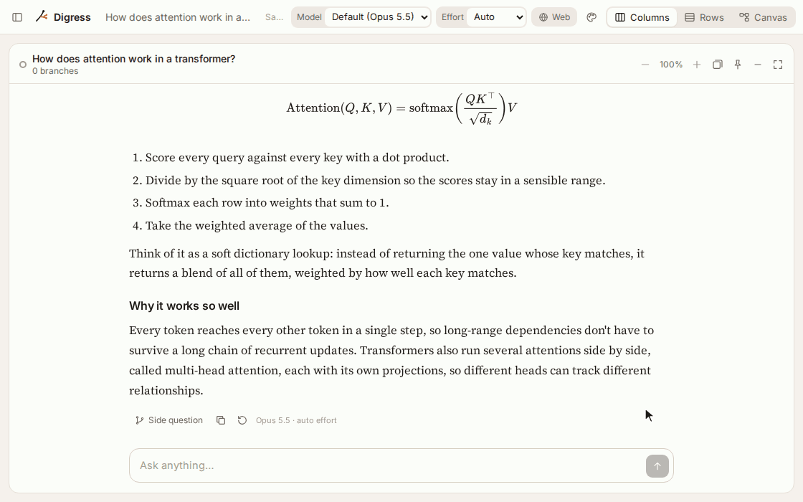
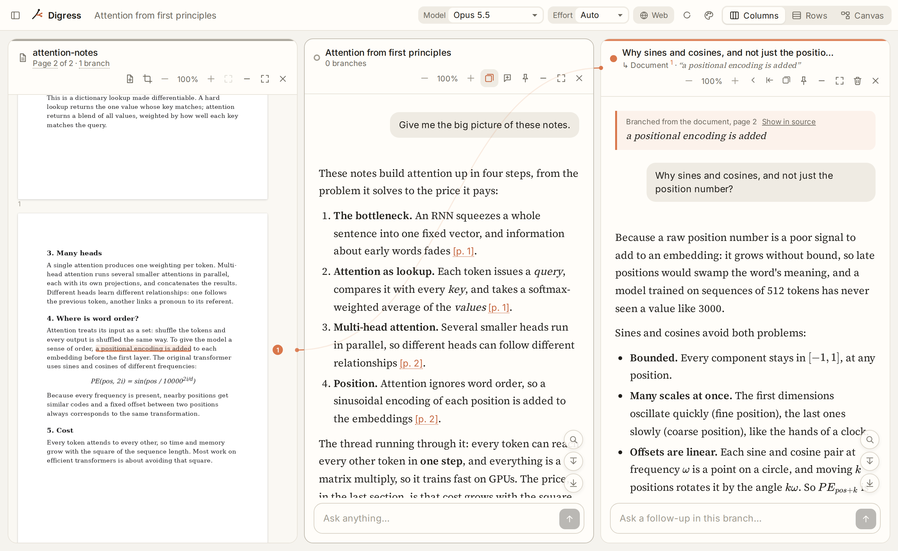
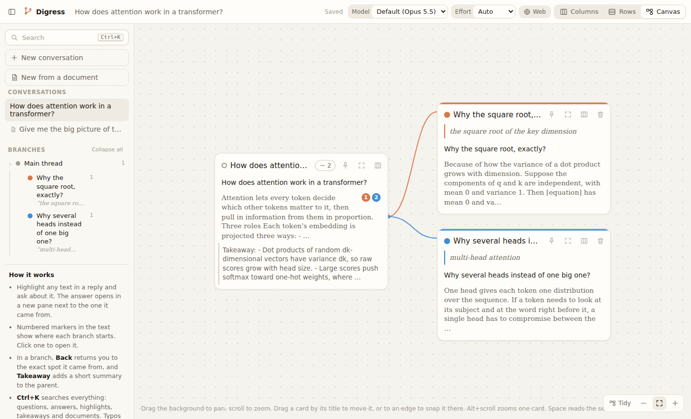

#  Digress

**A branching chat for learning.** Highlight any words in an answer, ask about them, and the reply opens in its own thread beside the one it came from. Follow a tangent as far as you like, then come back to exactly where you were.

https://github.com/user-attachments/assets/4435b865-4ed3-46e9-b086-07de01d6515c


## Why branch?

Learning something hard is not a straight line. A good explanation raises three new questions, and in a normal chat each one pushes the original thread further up the screen until you lose it. You either stop asking, or you end up with one long scroll where the main idea and every side question are tangled together.

Digress keeps them apart. Every question you ask about a passage becomes a **branch** that remembers the exact words it came from. The main thread stays readable, each side question gets a full, focused answer, and the shape of the conversation shows you how the ideas connect.



## Highlight → branch



Select any text in a reply and type a question (or pick a quick one: *Explain simpler*, *Example*, *Why?*, *Go deeper*). The answer opens in a new pane next to its parent.

- The model sees the whole conversation up to that point, plus the passage you picked, so the answer is about *that* sentence in *that* context.
- A numbered marker in the parent shows where each branch starts. Click it to open the branch; **Show in source** in the branch jumps back to the exact words and flashes them.
- Branches can branch again, as deep as you need. The sidebar shows the whole tree.

## Takeaways: carry it back

When a branch has answered your question, press **Takeaway**. Digress writes two to four bullets of what you learned and adds them to the end of the parent thread, optionally focused on what you ask for. The main thread then builds on them, so your understanding accumulates instead of staying scattered across tangents.

## Fix a reply: redo, edit, other versions

Picked the wrong model, or asked the wrong thing? **Redo** asks again with the model and effort selected now, and the pencil on a question lets you **edit** it. On the latest reply, with nothing hanging off it, the new answer simply replaces the old one. Further back, it becomes **another version**: the question asked again from the same point, in its own pane next to the original, so you can compare. Nothing that was there changes. The question shows how many versions it has, and **Use this version** makes the conversation go on with the one you prefer. The other one stays, and you can switch back. Branches you're done with can be hidden from the tree without deleting them.

While a reply is being written you see what it's doing (searching, reading pages) and for how long. Under each reply: the model and effort it used, and what it had of the document (all of it, or which pages it started from and read).

## Read with a document



Start from a **PDF, Markdown or text file, or a web article**: upload one, paste text, or paste a link and the server downloads it. A blog post or article opens in reader view (just the article, as Markdown, nothing on the page runs). Its images stay as placeholders until you load them. The document opens beside a main thread about the whole thing, and the model has its text, with page numbers. In a long PDF, click **Page N** in its header to jump to any page.

The model can also read the document itself. It can search it, read pages and look at a page as an image (for figures and tables), as many times as a question needs. A document up to about 200k characters (around 100 dense pages) is sent whole. For a longer one, the model starts from the table of contents and the first pages, then reads what the question needs. Under each reply you see what it read, with links to the pages. These tools only read the open document: nothing else on your machine.

- Highlight any passage in the PDF to branch about just that part. Markers sit in the margin of the page.
- Page references in answers, like [p. 2], are links that scroll the document there.
- Ask about a whole page, or snip a figure, table or equation, and the model gets a sharp image of it, rendered from the PDF.

You can also paste or drop screenshots into any message box: a plot from your notebook, a slide, a whiteboard photo.

## Remember it: flashcards (optional)

Turn on flashcards for a conversation and the model drafts cards from what you dug into: each highlight you branched from, each snip, each takeaway. They wait in an inbox until you keep, edit or delete them; **Make cards** drafts more from whatever changed since last time, and each branch has its own **Cards** button. Kept cards come back for review on a spaced-repetition schedule (FSRS), and each card links back to where it came from: the branch opens at the reply the card was made from, with the passage you highlighted flashing, and **Back to review** returns you to the same card (press **O** while reviewing). Reviewing works offline too: the page and your cards stay available in the browser, and reviews sync when the server is reachable again. Conversations where you don't turn it on look exactly as before. How it all works: [docs/flashcards.md](docs/flashcards.md).

## Three ways to see it

Switch views from the top bar at any time; the conversation is the same.

- **Columns:** threads side by side, each pane next to the one it branched from, with a line connecting each branch to its source.
- **Rows:** the same panes stacked top to bottom, each at full width.
- **Canvas:** the whole tree as cards on an infinite canvas. Pan, zoom, move cards, snap them to an edge or keep one stuck to the screen while you move around. Works with touch, too.



With a document, its card's **Expand** button (or dragging the card to an edge) docks the document itself beside the canvas: pages at full sharpness, and highlighting, snips and page jumps work as in Columns. **Canvas views** save an arrangement of the canvas under a name (the **Views** button in its corner), so you can switch between setups and open the same one on another device. Without them, each device keeps its own canvas and pane layout, since what fits on a laptop doesn't fit on a phone.

Answers render Markdown, code with syntax highlighting, LaTeX math and Mermaid diagrams. Panes collapse to thin strips, **Focus** hides everything else, and each pane keeps its own zoom. On a narrow window or a phone, whatever doesn't fit in the top bar moves into a ⋯ menu. The palette button switches themes: light and dark (or match your device), plus Sand, Sea glass, Rosé Pine Dawn, Gruvbox, Shades of Purple and Nord.

## Search everything

<kbd>⌘K</kbd> / <kbd>Ctrl+K</kbd> searches every conversation at once: questions, answers, highlights, takeaways and documents. It is a full-text index (BM25) that tolerates typos and takes you to the words it found, highlighted, inside the message or document page. A **Back** chip then returns you to where you were, even in another conversation. Press <kbd>Tab</kbd> in the search box to look only in this conversation or only in one thread, or click the magnifier at the bottom right of a pane to search just that thread. Half remember something but not the words? Choose **Describe it instead** under the results: the model suggests the words you probably used (it gets what you typed and your conversations' titles, never their text), and if that isn't enough you can let it pick from short snippets of the best matches. Pin the conversations and branches you keep coming back to, and archive the rest. Once you have a document conversation, **All · Docs · Chats** above the list shows just one kind. Double-click a title in the sidebar to rename it.

## Models: Claude and ChatGPT, on the plans you already pay for

Digress needs no API key if you already have a subscription.

- **ChatGPT, with your ChatGPT plan (Plus or Pro).** Run `npm run chatgpt -- login` once and sign in with your ChatGPT account. Digress uses OpenAI's *Sign in with ChatGPT* for open-source apps: it registers as its own app, calls the Responses API with `store: false`, and usage counts against your plan. Your plan's models appear in the model picker.
- **Claude, with your Claude subscription (Pro or Max).** If the [Claude Code](https://docs.claude.com/en/docs/claude-code) CLI is installed and signed in, Digress runs it for each reply with all of its own tools turned off and none of your Claude Code setup loaded (only web search when you ask, and the document tools above), so it answers on your plan.
- **Claude, with an Anthropic API key.** Put `ANTHROPIC_API_KEY` in `.env` and Digress calls the API directly, with prompt caching for long documents.

Claude and ChatGPT can be connected at the same time. Pick a model per message from the top bar (each reply shows which model wrote it), along with how much effort it should put in.

## Web search, only when you ask

Models answer from what they know unless you turn on **Web** in the top bar. Then they may search the web, link the pages they use right in the answer, and the reply lists its sources. It is search only: the search runs on Anthropic's or OpenAI's side, and the model gets no tool that fetches pages or runs anything on your machine.

## The prompts are yours to change

Everything Digress tells the model (the tutor instructions, how branches, takeaways and flashcards are asked for, how documents are introduced) is in one file, [`web/prompts.js`](web/prompts.js). Edit it and reload.

## On several devices

Open it from your laptop and your phone (see [Using it from other devices](docs/remote-access.md)) and they stay in step. Switch back to a tab and it picks up whatever you did elsewhere, without a reload; the layout stays as it was on that device. If both changed the same conversation, the two are combined and nothing is lost: when both asked from the same point, the later question becomes another version.

A reply keeps going on the server when your phone locks, you switch apps or conversations, or the page reloads, and the page picks it back up when you return. If nothing comes back for 10 minutes it stops, keeps what it wrote, and offers **Continue**.

## Your data stays on your machine

Digress is one HTML file (`web/index.html`) and a small Node server with no dependencies (`server/server.mjs`). Conversations and documents are plain JSON and files in `data/`; the only thing that leaves your machine is what you send to the model you picked. The server listens on `127.0.0.1`, has no accounts, and refuses requests from other websites.

## Quick start

Needs Node 18 or newer, plus at least one model connection from above.

```sh
git clone https://github.com/NeejWeej/digress && cd digress

# connect a model (any or all):
npm run chatgpt -- login         # ChatGPT, with your ChatGPT plan
claude                           # Claude Code, signed in with your Claude plan (then /exit)
echo 'ANTHROPIC_API_KEY=sk-ant-...' >> .env   # or an Anthropic API key

npm start                        # → http://127.0.0.1:8787
```

Open <http://127.0.0.1:8787>, click **New conversation** or **New from a document**, and ask something.

## More

- [Setup and configuration](docs/setup.md): each model connection in detail, `.env` options, documents from links, where data lives.
- [Using it from other devices](docs/remote-access.md): Tailscale, running it as a service, using it on your phone.
- [Development](docs/development.md): tests, live reload, regenerating these screenshots. [AGENTS.md](AGENTS.md) explains how the code fits together.
- [Future directions](docs/future.md): ideas for later, like sub-agents that explore and codebases as a source.
- [Flashcards](docs/flashcards.md): turning them on, where cards come from, the inbox, reviewing, offline.
- [Done](docs/done.md): ideas from that list that have been built.

## License

MIT

Developed with Claude Opus 5.5.
